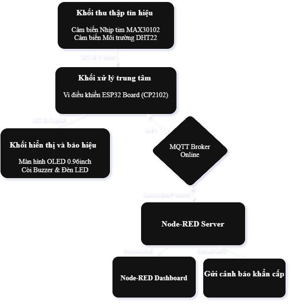
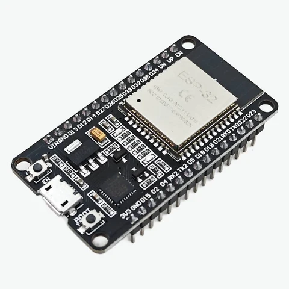
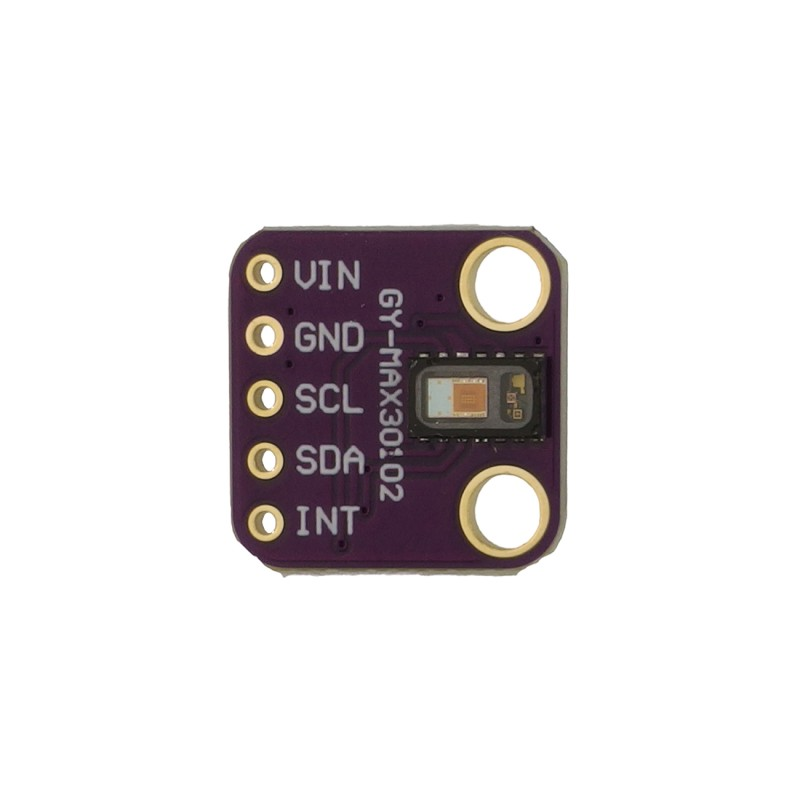
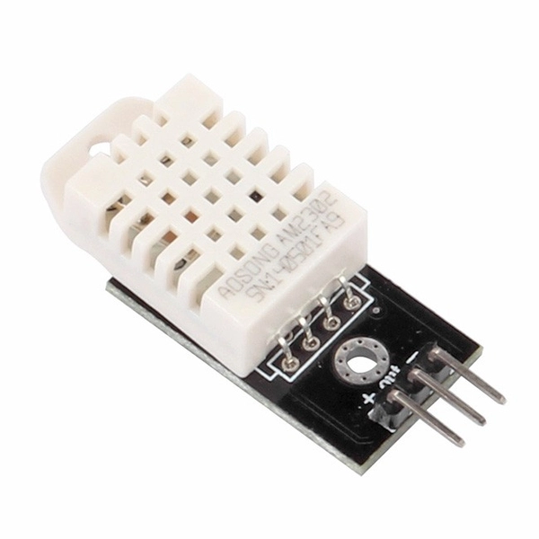
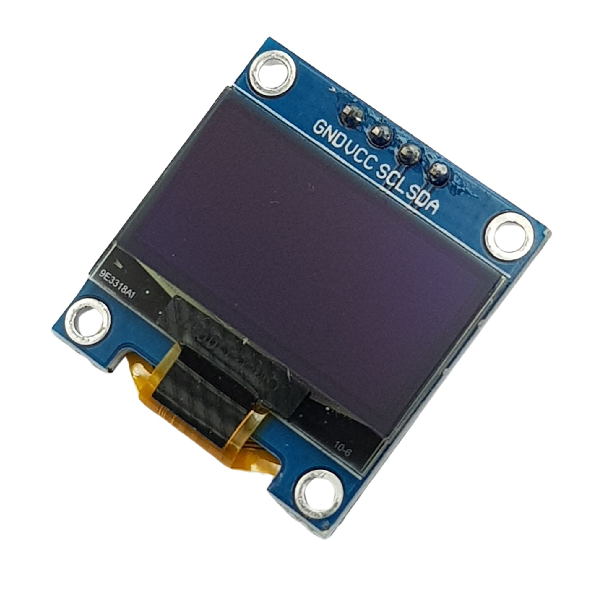
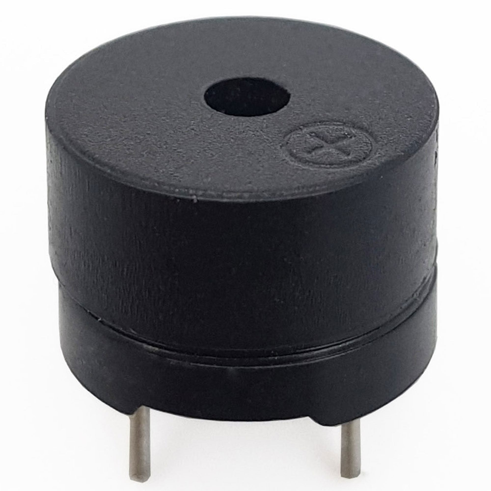
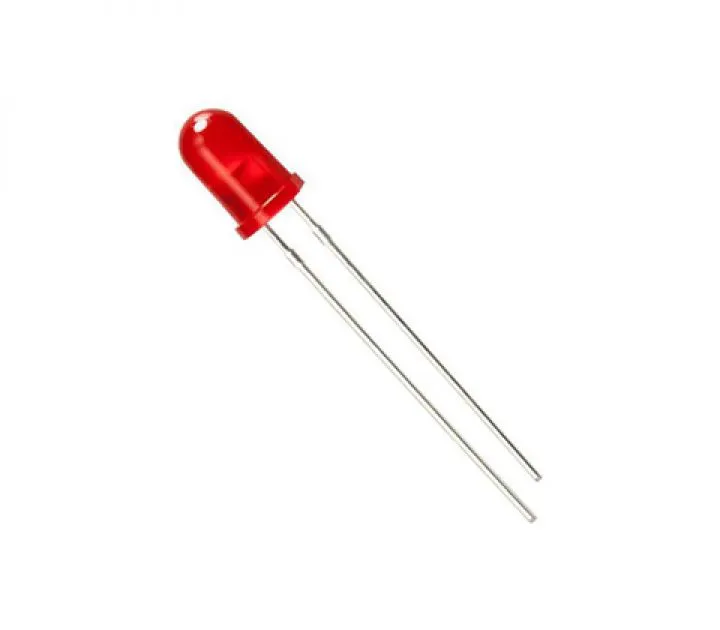
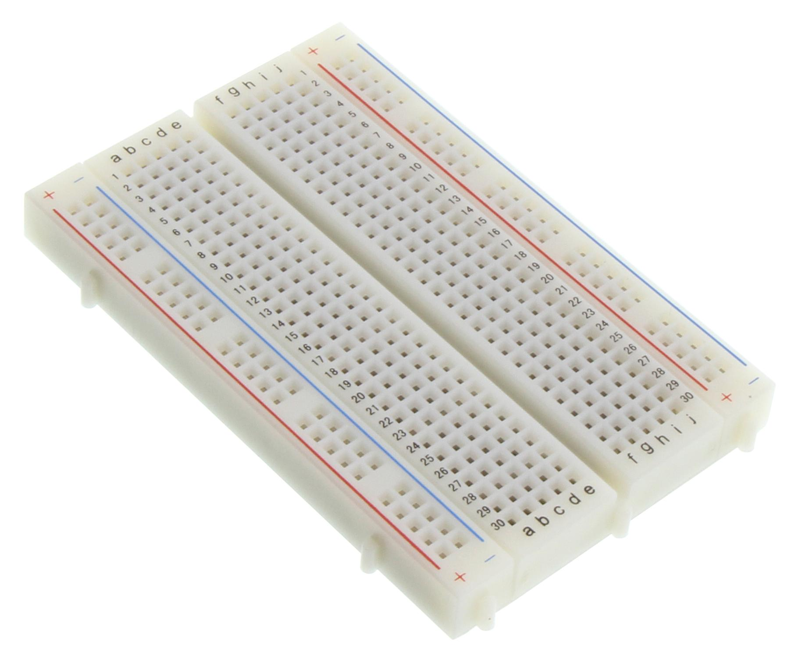
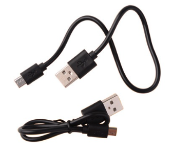
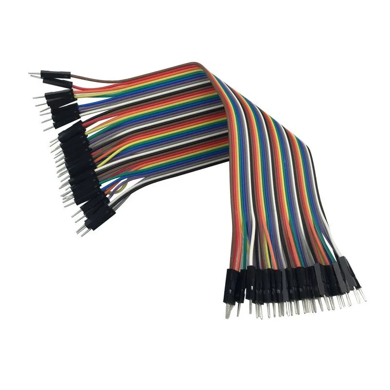

# HỆ THỐNG GIÁM SÁT SỨC KHỎE VÀ MÔI TRƯỜNG PHÒNG BỆNH TỪ XA QUA MQTT & NODE-RED

> **Đề tài cuối kỳ môn học:** Phát triển ứng dụng IoT  
> **Giảng viên hướng dẫn:** TS. Nguyễn Anh Tuấn  
> **Sinh viên thực hiện:** Lưu Minh Tuân - 23001637

## 1. Tên đề tài
Thiết kế hệ thống IoT giám sát nhịp tim và điều kiện môi trường phòng bệnh (nhiệt độ, độ ẩm) thời gian thực ứng dụng Node-RED và giao thức MQTT.

## 2. Đặt bài toán
- Bối cảnh thực tế: Việc chăm sóc sức khỏe người cao tuổi hoặc bệnh nhân tim mạch tại nhà đang là nhu cầu rất lớn. Các sự cố tim mạch thường có mối liên hệ mật thiết với môi trường xung quanh (ví dụ: trời quá lạnh dễ gây đột quỵ, hoặc độ ẩm quá cao gây khó thở). Tuy nhiên, các thiết bị y tế hiện nay thường phân mảnh (máy đo nhịp tim riêng, nhiệt kế phòng riêng) và thiếu tính năng cảnh báo từ xa cho người thân đi làm.
- Nguồn gốc ý tưởng & cảm hứng: Đề tài lấy cảm hứng từ mô hình "Phòng bệnh thông minh" (Smart Healthcare Room). Hệ thống không chỉ theo dõi chỉ số  nhịp tim - (BPM) mà còn giám sát không gian sống (nhiệt độ, độ ẩm phòng). Bằng việc kết hợp ESP32, MQTT và Node-RED, thiết bị sẽ phát tín hiệu báo động tại chỗ, đồng thời gửi đồ thị trực quan và tin nhắn khẩn cấp đến người nhà khi phát hiện bất kỳ thông số nào vượt ngưỡng an toàn.

## 3. Nội dung chính & Điểm sáng tạo
Hệ thống giải quyết bài toán bằng kiến trúc IoT toàn diện:
* Thu thập dữ liệu đa luồng: 
  - Đọc tín hiệu quang thể tích (PPG) từ MAX30102, qua bộ lọc để tính nhịp tim (BPM).
  - Đọc dữ liệu môi trường từ cảm biến DHT22 (nhiệt độ, độ ẩm không khí).
* Hiển thị & cảnh báo tại chỗ: Màn hình OLED SSD1306 liên tục cập nhật 3 thông số: BPM, Temp (*C), Humidity (%). Khi nhịp tim bất thường hoặc phòng quá nóng/lạnh, vi điều khiển lập tức kích hoạt còi (Buzzer) và đèn LED nháy sáng.
* Giao tiếp IoT (MQTT): ESP32 được lập trình trên PlatformIO, hoạt động như một MQTT Client, đóng gói dữ liệu JSON và publish liên tục lên một MQTT Broker online.
* Trực quan hóa & Điều khiển (Node-RED): 
  - Xây dựng Node-RED Dashboard hiển thị 3 biểu đồ (Gauge & Chart) cho nhịp tim, nhiệt độ và độ ẩm.
  - Giao diện cho phép người dùng thay đổi ngưỡng cảnh báo (Threshold) từ xa, gửi lệnh điều khiển ngược lại ESP32.
  - Sáng tạo: Tích hợp logic tự động gửi tin nhắn cảnh báo qua tin nhắn SMS và gmail cho người nhà khi các chỉ số rơi vào vùng nguy hiểm.

## 4. Sơ đồ khối dự kiến
Hệ thống được thiết kế theo cấu trúc tập trung, bao gồm 4 khối chính:

* **Khối Xử lý trung tâm:** Mạch ESP32_CP2102.
* **Khối Thu thập tín hiệu:** 
  - Cảm biến MAX30102 (Đo nhịp tim, giao tiếp I2C).
  - Cảm biến DHT22 (Đo nhiệt độ, độ ẩm phòng, giao tiếp 1-Wire Digital).
* **Khối Hiển thị và báo hiệu:** 
  - Màn hình OLED SSD1306 (Giao tiếp I2C).
  - Còi báo động (Active Buzzer) & Đèn LED cảnh báo.
* **Khối Giám sát IoT (Internet):** 
  - Giao thức truyền tải: MQTT qua mạng WiFi.
  - Server xử lý: Node-RED.
  - Giao diện người dùng cuối: Node-RED Dashboard (trên PC/Mobile) & Ứng dụng.

  

## 5. Danh sách phần cứng dự kiến

1. ESP32 CP2102 (Khối xử lý trung tâm).
2. Module MAX30102 (Cảm biến nhịp tim & SpO2).
3. Module DHT22 (Cảm biến nhiệt độ, độ ẩm).
4. Màn hình OLED SSD1306 0.96 inch.
5. Còi chip (Active Buzzer 5V) và Đèn LED.
6. Breadboard, dây cắm Jumper và cáp nguồn Micro_B-USB.

## 6. Hình ảnh phần cứng dự kiến

<table>
  <tr>
    <td align="center">
       
      <b>Mạch ESP32 CP2102</b>
    </td>
    <td align="center">
       
      <b>Cảm biến MAX30102</b>
    </td>
    <td align="center">
       
      <b>Cảm biến DHT22</b>
    </td>
  </tr>
  <tr>
    <td align="center">
       
      <b>Màn hình OLED 0.96"</b>
    </td>
    <td align="center">
       
      <b>Còi báo động Buzzer</b>
    </td>
    <td align="center">
       
      <b>Đèn LED cảnh báo</b>
    </td>
  </tr>
  <tr>
    <td align="center">
       
      <b>Breadboard</b>
    </td>
    <td align="center">
       
      <b>Cáp Micro_B</b>
    </td>
    <td align="center">
       
      <b>Dây cắm Jumper</b>
    </td>
  </tr>
</table>
